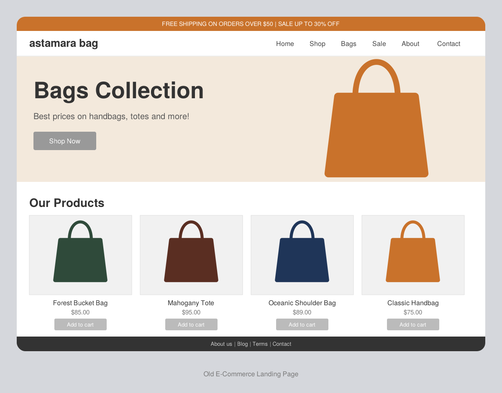
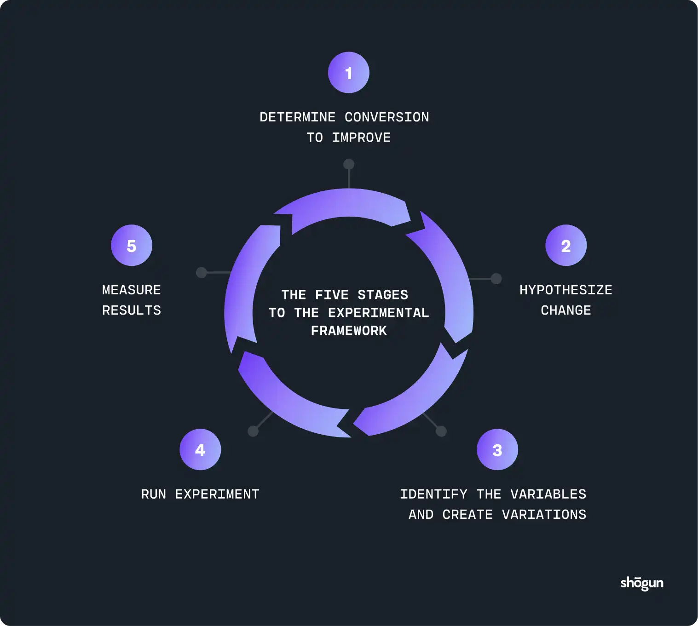

# 🛍️ E-Commerce A/B Testing Analysis

A Python and Streamlit-based data analytics project that compares two e-commerce landing pages using A/B testing. This project analyzes user conversion behavior, visualizes experiment results, and applies statistical tests to determine whether the observed difference in conversion rates is statistically significant.

The interactive dashboard presents key performance metrics, data visualizations, hypothesis testing results, confidence intervals, and business insights to support data-driven decisions.

---

## 🚀 Live Dashboard

**Streamlit Application:** [Click Here to Open Live Dashboard](YOUR_STREAMLIT_LINK_HERE)

*Note: The live dashboard link will be updated after deploying the project on Streamlit Community Cloud.*

---

## 🎯 Project Objectives

- Compare conversion rates between the old landing page (Control Group) and new landing page (Treatment Group).
- Clean and validate the experiment dataset.
- Analyze visitor counts, conversions, and conversion percentages.
- Visualize experiment results using charts and graphs.
- Apply Two-Proportion Z-Test and Chi-Square Test.
- Calculate a 95% Confidence Interval.
- Build an interactive dashboard using Streamlit.
- Interpret statistical findings from a business perspective.

---

## 🖥️ Old vs New Landing Page

The experiment compares two different e-commerce landing page designs.

### Old Landing Page – Control Group



### New Landing Page – Treatment Group


The objective is to analyze how users interact with the two experiment groups and compare their conversion behavior.

---

## 🔄 A/B Testing Workflow



The workflow includes:

1. Collecting experiment data.
2. Dividing users into control and treatment groups.
3. Comparing conversion outcomes.
4. Performing statistical analysis.
5. Interpreting the results.

---

## 📊 Dataset

**Dataset:** AB Testing Conversion Rate

**Source:** https://github.com/yangfuchun/AB_Testing_Conversion_Rate

The dataset contains information about users, experiment groups, landing pages, timestamps, and conversion outcomes.

Save the CSV file in the project directory as `dataset.csv`.

### Dataset Columns

| Column | Description |
|---|---|
| `user_id` | Unique identifier for each user |
| `timestamp` | Date and time of the experiment |
| `group` | Experiment group (control or treatment) |
| `landing_page` | Page shown (old_page or new_page) |
| `converted` | 1 = Converted, 0 = Not Converted |

**Note:** The dataset measures conversion outcomes only. It does not contain purchase amounts or revenue.

---

## 📁 Project Structure

```text
My-Anatomy-Module2/
│
├── app.py
├── analysis.py
├── dataset.csv
├── requirements.txt
├── README.md
├── .gitignore
│
└── images/
    ├── old_landing_page.png
    ├── new_landing_page.png
    └── ab_testing_workflow.png
```

### File Description

- `app.py` – Streamlit dashboard interface, KPIs, charts, and statistical results.
- `analysis.py` – Data loading, cleaning, summary statistics, and hypothesis testing.
- `dataset.csv` – Input dataset used for analysis.
- `requirements.txt` – Required Python libraries.
- `README.md` – Project documentation.
- `.gitignore` – Excludes unnecessary files from GitHub.
- `images/` – Contains landing page designs and workflow images.

---

## 🛠️ Technologies Used

- Python
- Pandas
- NumPy
- Streamlit
- Matplotlib
- Seaborn
- SciPy
- Statsmodels

---

## ⚙️ Setup and Installation

### 1. Clone the Repository

```bash
git clone https://github.com/sahuanshika557-sys/My-Anatomy-Module2.git
```

### 2. Navigate to the Project Folder

```bash
cd My-Anatomy-Module2
```

### 3. Create a Virtual Environment

```bash
python -m venv .venv
```

Activate on Windows Command Prompt:

```bash
.venv\Scripts\activate.bat
```

### 4. Install Dependencies

```bash
python -m pip install -r requirements.txt
```

### 5. Run the Dashboard

```bash
python -m streamlit run app.py
```

The dashboard will open at:

`http://localhost:8501`

---

## 🔍 Analysis Workflow

1. **Data Loading:** Load the experiment dataset using Pandas.
2. **Data Cleaning:** Handle missing values, invalid records, and duplicate user entries.
3. **Data Validation:** Check experiment groups and corresponding landing pages.
4. **Exploratory Data Analysis:** Explore visitor counts, conversions, and conversion rates.
5. **Data Visualization:** Generate charts to compare both groups.
6. **Hypothesis Testing:** Apply statistical tests.
7. **Confidence Interval:** Calculate the 95% confidence interval.
8. **Business Interpretation:** Explain the results and their implications.

### Data Cleaning Rules

- Parse timestamps into datetime format.
- Validate required columns and conversion values.
- Remove records with missing or invalid required values.
- Keep control group records associated with `old_page`.
- Keep treatment group records associated with `new_page`.
- Sort records by timestamp and retain the first valid record for each user.

**Note:** Keeping the first valid record per user is a project-specific cleaning decision. A production experiment should verify assignment consistency and duplicate-record handling.

---

## 📈 Statistical Methods

### 1. Conversion Rate

Conversion Rate = (Number of Conversions / Total Visitors) × 100

### 2. Two-Proportion Z-Test

- **Null Hypothesis (H₀):** The population conversion rates of both groups are equal.
- **Alternative Hypothesis (H₁):** The population conversion rates are different.
- **Significance Level:** α = 0.05

**Decision Rule:**

- If p-value < 0.05, reject H₀.
- If p-value ≥ 0.05, fail to reject H₀.

### 3. Chi-Square Test

A Chi-Square Test of Independence examines the relationship between experiment group and conversion outcome.

### 4. 95% Confidence Interval

The confidence interval is calculated for:

**Treatment Conversion Rate − Control Conversion Rate**

- Entirely above zero: Positive treatment difference.
- Entirely below zero: Negative treatment difference.
- Includes zero: No statistically significant difference is established at the corresponding two-sided 5% level.

---

## 📊 Dashboard Features

- Cleaned dataset preview.
- Missing-value summary.
- Experiment overview.
- Control and treatment conversion-rate metrics.
- Absolute conversion-rate difference.
- Relative conversion lift.
- Experiment group-size visualization.
- Conversion outcome comparison.
- Conversion-rate comparison chart.
- Daily conversion trend analysis.
- Two-Proportion Z-Test results.
- Chi-Square Test results.
- 95% Confidence Interval.
- Business interpretation of experiment results.

---

## 📌 Key Findings

Based on the analyzed experiment dataset:

| Metric | Result |
|---|---:|
| Control Conversion Rate | 12.04% |
| Treatment Conversion Rate | 11.88% |
| Relative Lift | -1.31% |
| Conversion Rate Difference | -0.16 percentage points |
| Z-Statistic | 1.3109 |
| Z-Test p-value | 0.189883 |
| Chi-Square Statistic | 1.7036 |
| Chi-Square p-value | 0.191822 |
| Significance Level | 0.05 |

### Business Interpretation

- The old landing page recorded a slightly higher observed conversion rate.
- The new landing page showed a relative lift of approximately -1.31%.
- Both statistical tests produced p-values greater than 0.05.
- Therefore, we fail to reject the null hypothesis.
- The observed difference is not statistically significant at the 5% level.

**Conclusion:** The experiment does not provide sufficient statistical evidence that the new landing page performs differently from the old landing page. This does not prove that both landing pages are identical.

---

## ⚠️ Limitations

- The dataset measures conversion outcomes, not revenue or profit.
- Statistical significance alone is not enough to make a business decision.
- Results depend on proper random assignment and data quality.
- Conclusions depend on selected data-cleaning assumptions.
- Daily conversion trends are descriptive.
- This project is intended for educational and analytical purposes.

---

## 🚀 Future Improvements

- Deploy the dashboard using Streamlit Community Cloud.
- Add interactive date-range filters.
- Include downloadable analysis reports.
- Add automated data-quality validation.
- Introduce additional statistical testing methods.
- Improve dashboard interactivity and visualizations.

---

## 🎓 Learning Outcomes

Through this project, I gained practical experience in:

- Data cleaning and preprocessing.
- Exploratory Data Analysis (EDA).
- Data visualization and interpretation.
- A/B testing concepts.
- Conversion-rate analysis.
- Hypothesis testing.
- Confidence interval calculation.
- Building interactive dashboards using Streamlit.
- Communicating data-driven business insights.

---

## 🙏 Acknowledgements

The dataset used in this project is sourced from the [AB Testing Conversion Rate Repository](https://github.com/yangfuchun/AB_Testing_Conversion_Rate).

Thanks to the dataset contributors for making the data available for learning and experimentation.

---

**Developed with Python, Data Analytics, Statistical Testing, and Streamlit.**

**GitHub Repository:** [My-Anatomy-Module2](https://github.com/sahuanshika557-sys/My-Anatomy-Module2)
